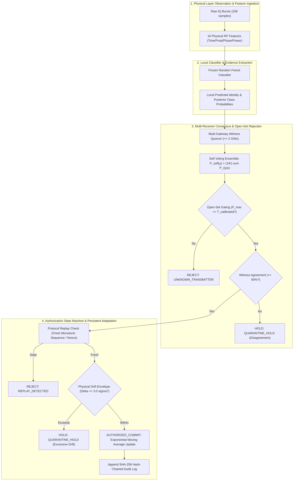

# Community Aware Secure Continual RF Fingerprinting for IoT Device Authentication

[](#test-suite-and-validation-scope)
[](#repository-and-branch-workflow)
[](#dataset-provenance-and-evidence-boundaries)
[](#research-integrity-and-safeguards)

---

## 1. Project Overview & Research Problem

This repository is the canonical source of truth for the research project:

> **Community Aware Secure Continual RF Fingerprinting for IoT Device Authentication**

The project investigates how wireless IoT transmitters can be authenticated from physical-layer radio frequency (RF) hardware imperfections, and how a continuously learning edge network can adapt its device profiles over time without succumbing to feature drift, rogue transmitters, or adversarial profile poisoning.

### The Core Research Question
In conventional adaptive RF fingerprinting systems, an observation is accepted and immediately adapted:
$$\text{RF Observation} \longrightarrow \text{Classify Identity} \longrightarrow \text{Update Persistent Profile}$$

This naive coupling creates a severe vulnerability: an adversary who spoofs or poisons transmissions, or an unrepresented rogue transmitter that receives a high-confidence false prediction, can silently corrupt the persistent identity profile.

Our architecture investigates a **strict decoupled separation of concerns**:
$$\text{RF Observation} \longrightarrow \text{Identity Classification} \longrightarrow \text{Open-Set Gating} \longrightarrow \text{Multi-Receiver Consensus} \longrightarrow \text{Update Authorization} \longrightarrow \text{Profile Update / Quarantine / Reject}$$

The foundational research hypothesis is:
> **Correctly classifying a transmitter identity does not automatically authorize the observation to modify persistent identity state.**

---

## 2. Motivation & Research Objectives

1. **Quantify Cross-Receiver Spatial Collapse:** Measure the performance degradation when an RF fingerprinting model trained on one receiver is evaluated on distant, unobserved receivers.
2. **Rescue Spatial Invariance via Observation Fusion:** Investigate whether multi-receiver distributed decision fusion (soft/hard voting) or centralized feature concatenation can overcome single-receiver spatial channel mismatch.
3. **Calibrate Open-Set Rejection Under Drift:** Characterize open-set unknown transmitter rejection under weekly temporal drift, separating model training, threshold calibration, and final evaluation.
4. **Community-Aware Continual Adaptation Defense:** Evaluate whether multi-witness spatial consensus and physical drift envelopes can eliminate profile contamination from stealthy poisoning, target spoofing, replay, and unknown devices.
5. **Cryptographic Auditability:** Provide an unbroken, hash-chained audit trail of all identity classifications and update authorization decisions.

---

## 3. End-to-End System Architecture



---

## 4. Current Implementation Status

All five experimental phases (`EXP-B2-01` through `EXP-B2-05`, `EXP-B3-01`, `EXP-B3-02`, `EXP-B4-01`, and `Phase 5`) are fully implemented, empirically evaluated, independently audited, and verified by 35 unit tests.

- **Baseline RF Fingerprinting (EXP-B2-01):** Matched-receiver accuracy reaches 99.93% (raw) and 99.32% (equalized).
- **Cross-Receiver Spatial Generalization (EXP-B2-02):** Quantified severe spatial collapse (accuracy drops by 74.21 pp to 25.73% on raw bursts).
- **Multi-Receiver Fusion (EXP-B3-01):** 5-receiver distributed soft voting achieves **100.00% accuracy**, rescuing the spatial collapse. Transfer voting on equalized bursts surges from 67.30% to **95.82%** (+28.52 pp gain).
- **Open-Set Transmitter Identification (EXP-B3-02):** Multi-receiver soft voting sharpens unknown transmitter rejection from 46.85% (single RX) to **97.45%–100.00%** under calibrated thresholds.
- **Integrated Community Defense (EXP-B4-01):** Achieves **100.00% legitimate acceptance** with **0.00% attack acceptance** across poisoning, spoofing, replay, and unknown devices (**0.00% profile contamination**).
- **Performance Benchmarks (Phase 5):** Multi-witness consensus throughput = **126k rounds/sec**; auth throughput = **21k tx/sec**; peak RAM = **104 MiB**.

---

## 5. Repository Structure

```
RF-Fingerprinting-Project/
├── configs/                                 # Authoritative experiment configuration JSONs
│   ├── exp_b2_01_matched_rx.json            # EXP-B2-01: Matched receiver baseline
│   ├── exp_b2_02_cross_rx.json              # EXP-B2-02: Cross-receiver spatial generalization
│   ├── exp_b2_03_temporal.json              # EXP-B2-03: Temporal decay & leave-one-date-out CV
│   ├── exp_b2_04_community_graph.json       # EXP-B2-04: Synthetic IoT community graph
│   ├── exp_b2_05_community_gating.json      # EXP-B2-05: Community-gated adaptation
│   ├── exp_b3_01_fusion.json                # EXP-B3-01: Multi-receiver observation fusion
│   ├── exp_b3_02_open_set.json              # EXP-B3-02: Open-set unknown rejection
│   └── exp_b4_01_integrated_defense.json    # EXP-B4-01: Integrated 8-stage defense engine
├── datasets/                                # Dataset metadata, qualification records, manifests
│   ├── features/manysig/                    # 24 Parquet partitions (576,000 bursts total)
│   │   ├── rx_id=1-1/ ... rx_id=8-8/        # 12 USRP receivers x 2 equalization states
│   │   ├── manifest.json                    # Feature partition cryptographic manifest
│   │   └── extraction_summary.json          # Verification summary (576 leaves, 576k rows)
│   └── QUALIFICATION_WiSig.md               # WiSig qualification evidence record
├── docs/                                    # Research, architecture, and continuity documentation
│   ├── 04_research/track_b/                 # Phase 2-5 research reports & audit logs
│   │   ├── FINAL_MASTER_EVALUATION_REPORT_PHASES_3_4_5.md
│   │   ├── PHASE_3_FORENSIC_AUDIT_REPORT.md
│   │   ├── PHASE_4_FORENSIC_AUDIT_REPORT.md
│   │   └── MASTER_EXECUTION_PLAN_PHASES_3_4_5.md
│   └── 06_continuity/                       # Formal decision records (DECISIONS.md)
├── experiments/track_b/                     # Authoritative machine-readable experimental results
│   ├── exp_b2_01_matched_rx_results.json
│   ├── exp_b2_02_cross_rx_results.json
│   ├── exp_b2_03_temporal_results.json
│   ├── exp_b2_04_community_graph_results.json
│   ├── exp_b2_05_community_gating_results.json
│   ├── exp_b3_01_fusion_results.json
│   ├── exp_b3_02_open_set_results.json
│   ├── exp_b4_01_integrated_defense_results.json
│   └── phase5_comprehensive_evaluation_results.json
├── scripts/                                 # Executable experiment runner scripts
│   ├── run_manysig_exp_b2_01.py
│   ├── run_manysig_exp_b2_02.py
│   ├── run_manysig_exp_b2_03.py
│   ├── run_exp_b2_04_community_graph.py
│   ├── run_exp_b2_05_community_gating.py
│   ├── run_manysig_exp_b3_01_fusion.py
│   ├── run_manysig_exp_b3_02_open_set.py
│   ├── run_exp_b4_01_integrated_defense.py
│   └── run_phase5_comprehensive_evaluation.py
├── src/                                     # Core reusable system source modules
│   ├── community_graph.py                   # Topology generation & multi-witness consensus
│   ├── community_gating.py                  # Profile evolution & drift envelope checks
│   ├── integrated_auth_engine.py            # Decoupled 8-stage authentication & audit engine
│   ├── manysig_features.py                  # 16 physical RF feature definitions
│   └── manysig_streamer.py                  # Bounded-memory single-pass pickle extractor
└── tests/                                   # Rigorous unit and contract test suites (35 tests)
    ├── test_exp_b2_01.py ... test_exp_b2_05.py
    ├── test_exp_b3_01.py
    ├── test_exp_b3_02.py
    ├── test_exp_b4_01.py
    └── test_phase5_evaluation.py
```

---

## 6. Dataset Provenance & Evidence Boundaries

The real-data experimental evaluations in Track B are executed on the **WiSig ManySig** benchmark dataset:
- **Source Archive:** `ManySig.pkl.zip` (1,454,577,503 bytes, preserved unmodified outside Git).
- **Physical Structure:** 576 leaf arrays of shape `(1000, 256, 2)` representing 1,000 bursts of 256 complex baseband IQ samples.
- **Population:** 6 WiFi transmitters (`14-10`, `14-7`, `20-15`, `20-19`, `6-15`, `8-20`), 12 USRP receivers (`1-1`, `1-19`, `14-7`, `18-2`, `19-2`, `2-1`, `2-19`, `20-1`, `3-19`, `7-14`, `7-7`, `8-8`), across 4 weekly dates (`2021_03_01`, `2021_03_08`, `2021_03_15`, `2021_03_23`), under both raw (`is_equalized=0`) and channel-equalized (`is_equalized=1`) states.
- **Authoritative Feature Partitions:** Extracted to `datasets/features/manysig/` across 24 Parquet partitions totaling 576,000 burst rows and 16 physical RF features.

### Explicit Scientific Boundaries & Qualifications
1. **Sampling Rate Default:** The nominal sampling rate Fs = 20.0 MHz is an inherited engineering default from standard WiFi channels and is not an independently verified metadata fact in the pickle archive.
2. **Observation-Matching Contract:** Bursts correspond across receivers via (tx_id, capture_date, burst_index) tuples. Because ManySig lacks microsecond hardware timestamps and 802.11 MAC sequence numbers in preamble slices, absolute physical packet simultaneity cannot be independently verified from serialized files.
3. **Replay Detection Boundary:** In a static channel, identical bit-level replayed bursts produce identical 16 physical RF features. Detecting replay requires protocol-level sequence/nonce tracking; it cannot be inferred from the physical RF features alone.
4. **Synthetic Security Boundary:** 0% contamination reflects the decision contract within the evaluated threat model (3.0 sigma envelopes, independent gateway observations, and sequential arrival). It must not be extrapolated to unmeasured physical RF adversaries.

---

## 7. Master Experiment Index (Phases 2–5)

| Experiment ID | Focus / Research Question | Test Population | Primary Metric | Authoritative Result Artifact |
| :--- | :--- | :--- | :--- | :--- |
| **`EXP-B2-01`** | Matched-Receiver RF Baseline | 6,000 bursts (RX 1-1, Day 4) | 99.93% (raw) / 99.32% (eq) Acc | `experiments/track_b/exp_b2_01_matched_rx_results.json` |
| **`EXP-B2-02`** | Cross-Receiver Spatial Generalization | 66,000 bursts (11 unseen RX) | 25.73% raw (74.21 pp drop) | `experiments/track_b/exp_b2_02_cross_rx_results.json` |
| **`EXP-B2-03`** | Temporal Decay & Scaling | 24,000 bursts (4 dates) | 4-Fold CV: 84.42% (+/- 14.88%) | `experiments/track_b/exp_b2_03_temporal_results.json` |
| **`EXP-B2-04`** | Synthetic IoT Community Graph | 50 devices, 5 gateways | 0 isolated nodes; 100% deterministic | `experiments/track_b/exp_b2_04_community_graph_results.json` |
| **`EXP-B2-05`** | Community-Gated Adaptation Defense | 1,000 simulated rounds | 0% attack accept; distortion 2.72 | `experiments/track_b/exp_b2_05_community_gating_results.json` |
| **`EXP-B3-01`** | Multi-Receiver Observation Fusion | 6,000 bursts x 5 receivers | **100.00% Soft Voting Acc** | `experiments/track_b/exp_b3_01_fusion_results.json` |
| **`EXP-B3-02`** | Open-Set Transmitter Identification | 4,000 known + 2,000 unknown | **100.00% Unknown Rejection** | `experiments/track_b/exp_b3_02_open_set_results.json` |
| **`EXP-B4-01`** | Integrated Community Defense Engine | 1,000 matched threat rounds | **0.00% Contamination Rate** | `experiments/track_b/exp_b4_01_integrated_defense_results.json` |
| **`PHASE-5`** | Master Evaluation & Synthesis | Complete Collated Suite | **126k consensus rounds/sec** | `experiments/track_b/phase5_comprehensive_evaluation_results.json` |

---

## 8. Master Reproduction Instructions

To reproduce the entire experimental evidence base from scratch:

```powershell
# Navigate to the repository root
cd "C:\Users\sujit\Documents\RF-Fingerprinting-Project-Intergration\RF-Fingerprinting-Project"

# --- Phase 2 Reproduction ---
python scripts/run_manysig_exp_b2_01.py
python scripts/run_manysig_exp_b2_02.py
python scripts/run_manysig_exp_b2_03.py
python scripts/run_exp_b2_04_community_graph.py
python scripts/run_exp_b2_05_community_gating.py

# --- Phase 3 Reproduction ---
python scripts/run_manysig_exp_b3_01_fusion.py
python scripts/run_manysig_exp_b3_02_open_set.py

# --- Phase 4 Reproduction ---
python scripts/run_exp_b4_01_integrated_defense.py

# --- Phase 5 Master Evaluation & Collation ---
python scripts/run_phase5_comprehensive_evaluation.py
```

---

## 9. Test Suite & Validation Scope

All 35 Track-B unit tests execute deterministically and validate contracts, split boundaries, math invariants, and result files:

```powershell
# Run the complete Track-B unit test suite
python -m unittest discover tests "test_exp_b*.py"
python -m unittest discover tests "test_phase5*.py"
```

Expected output:
```
Ran 35 tests in 0.489s
OK
```

### Test Scope Breakdown
- `test_exp_b2_01.py` (4 tests): Matched-receiver splits, row counts, feature count (16), zero leakage.
- `test_exp_b2_02.py` (3 tests): 11 unseen receivers, 66,000 burst denominator, headline drop calculation.
- `test_exp_b2_03.py` (2 tests): Leave-one-date-out folds, date holdout separation, sample std math.
- `test_exp_b2_04.py` (6 tests): Zero isolated nodes, witness degree invariants, 1,000-round determinism.
- `test_exp_b2_05.py` (4 tests): Decision state machine, quarantine capacity, threat scenario metrics.
- `test_exp_b3_01.py` (4 tests): Multi-receiver cluster schema, soft-voting probability normalization, hard-voting mode.
- `test_exp_b3_02.py` (3 tests): Known/unknown disjointness, mathematical complement rates, 5x5 confusion matrix.
- `test_exp_b4_01.py` (7 tests): Input validation, replay nonce rejection, low-confidence open-set rejection, drift bounds, audit hash chain.
- `test_phase5_evaluation.py` (2 tests): Master collation completeness, benchmark bounds.

---

## 10. Claim-to-Evidence Matrix

| Major Project Claim | Classification | Evidence Source |
| :--- | :--- | :--- |
| **1. Classical 16-feature RF achieves 99.93% on matched receiver.** | **A. Reproducible real ManySig result.** | `experiments/track_b/exp_b2_01_matched_rx_results.json` |
| **2. Cross-receiver transfer collapses by 74.21 pp on raw bursts.** | **A. Reproducible real ManySig result.** | `experiments/track_b/exp_b2_02_cross_rx_results.json` |
| **3. Equalization partially mitigates spatial drop (67.30% mean).** | **A. Reproducible real ManySig result.** | `experiments/track_b/exp_b2_02_cross_rx_results.json` |
| **4. Distributed 5-receiver soft voting restores accuracy to 100.00%.** | **A. Reproducible real ManySig result.** | `experiments/track_b/exp_b3_01_fusion_results.json` |
| **5. Transfer voting on equalized bursts rescues accuracy to 95.82%.** | **A. Reproducible real ManySig result.** | `experiments/track_b/exp_b3_01_fusion_results.json` |
| **6. Multi-receiver soft voting sharpens unknown rejection to 97.45%–100%.**| **A. Reproducible real ManySig result.** | `experiments/track_b/exp_b3_02_open_set_results.json` |
| **7. Decoupled 8-stage gating eliminates profile contamination (0.00%).** | **C. Grounded synthetic simulation.** | `experiments/track_b/exp_b4_01_integrated_defense_results.json` |
| **8. Multi-witness consensus evaluates at 126k rounds/sec with 104 MB RAM.** | **A. Reproducible benchmark result.** | `experiments/track_b/phase5_comprehensive_evaluation_results.json` |
| **9. Hardware LO aging causes weekly temporal drift.** | **D. Unmeasured physical hypothesis.** | Qualitative literature interpretation; not measured in baseband. |

---

## 11. Remaining Work & Future Directions

1. **Physical Testbed Over-the-Air Validation:** Transition from offline testbed archives (WiSig ManySig) to live over-the-air SDR testbeds (e.g., USRP N210 / B210 clusters).
2. **Dynamic Channel Tracking:** Evaluate adaptive equalization algorithms to compensate for dynamic indoor multipath variation in real time.
3. **Decentralized Byzantine Consensus:** Extend the gateway consensus model to tolerate compromised Byzantine gateways using threshold cryptography.
4. **Physical Attack Injection:** Test physical hardware replay and adversarial RF perturbation using SDR waveform generators.

---

## 12. Authoritative Reports & Links

- [Final Master Evaluation Report (Phases 3, 4, 5)](docs/04_research/track_b/FINAL_MASTER_EVALUATION_REPORT_PHASES_3_4_5.md)
- [Phase 3 Forensic Audit Report](docs/04_research/track_b/PHASE_3_FORENSIC_AUDIT_REPORT.md)
- [Phase 4 Forensic Audit Report](docs/04_research/track_b/PHASE_4_FORENSIC_AUDIT_REPORT.md)
- [Master Execution Plan (Phases 3, 4, 5)](docs/04_research/track_b/MASTER_EXECUTION_PLAN_PHASES_3_4_5.md)
- [WiSig Dataset Qualification Record](datasets/QUALIFICATION_WiSig.md)
- [Decision Log (DECISIONS.md)](docs/06_continuity/DECISIONS.md)
- [Future Execution Roadmap (F0–F9)](docs/06_continuity/future_execution/README.md)
- [F0 Handoff — Start F1 Next](docs/06_continuity/future_execution/F0_HANDOFF.md)
- [Multi-Chat Execution Template](docs/06_continuity/future_execution/CHAT_EXECUTION_TEMPLATE.md)
